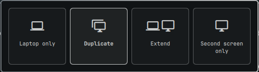

# Display Mode para Omarchy

[English](README.md) · **Español**

Un selector de modo de pantalla al estilo Win+P para la barra de [Omarchy](https://omarchy.org/). Haz clic en el icono, elige una de las cuatro tarjetas y la laptop y la segunda pantalla se reacomodan solas.



| Modo | Qué hace |
|------|----------|
| **Solo laptop** | Todo vive en la laptop. La segunda pantalla sigue encendida y muestra el salvapantallas de Omarchy, sin barra, ventanas ni espacios de trabajo. |
| **Duplicar** | Las dos pantallas muestran la misma imagen a la resolución más alta que comparten, copiada píxel a píxel y sin reescalado del compositor. |
| **Extender** | La segunda pantalla queda a la derecha de la laptop y siempre arranca en el espacio de trabajo 2. |
| **Solo segunda pantalla** | El panel de la laptop se apaga y todo pasa a la segunda pantalla. |

El modo elegido se conserva tras recargar y reiniciar. Si desconectas la segunda pantalla, la laptop vuelve a encenderse sola; al conectarla de nuevo se restaura el último modo.

## Requisitos

- Omarchy con plugins de terceros para el shell (`omarchy-shell`, basado en Quickshell)
- Hyprland con la configuración en Lua que trae Omarchy
- Una laptop con panel integrado (`eDP`, `LVDS` o `DSI`) y una pantalla externa
- `jq`, `socat`, `grim` y `ttfx`, que ya vienen en una instalación normal de Omarchy

## Instalación

```sh
omarchy plugin add https://github.com/AldoHassiel/omarchy-display-mode.git --enable
```

El icono aparece justo a la derecha del reloj. Para ponerlo en otro lugar:

```sh
omarchy bar move aldo.display-mode --section right
```

Nada cambia en tus pantallas hasta que eliges un modo por primera vez. En ese momento el plugin añade un include al final de `~/.config/hypr/hyprland.lua`, para que las reglas que genera en `~/.config/hypr/display-mode.lua` se carguen al último.

## Uso

Haz clic en el icono de la barra para abrir las cuatro tarjetas.

| Acción | Teclas |
|--------|--------|
| Moverse entre tarjetas | `h` `j` `k` `l`, flechas o el mouse |
| Aplicar la tarjeta resaltada | `Enter`, `Espacio` o clic |
| Aplicar una tarjeta directamente | `1` `2` `3` `4` |
| Cerrar | `Esc` o clic fuera |

La tarjeta del modo activo aparece resaltada y el icono de la barra cambia con él. Sin segunda pantalla conectada solo está disponible **Solo laptop**.

Para abrir el panel con un atajo de teclado, añade esto a `~/.config/hypr/bindings.lua` con la combinación que prefieras:

```lua
o.bind("SUPER + CTRL + P", "Display mode", "omarchy-shell aldo.display-mode toggle")
```

Los mismos modos están disponibles desde una terminal, lo que también sirve para salir de una pantalla en negro:

```sh
~/.config/omarchy/plugins/aldo.display-mode/display-mode set internal   # o duplicate, extend, external
~/.config/omarchy/plugins/aldo.display-mode/display-mode status
```

## Duplicar y la nitidez

Por defecto, Duplicar hace lo mismo que Windows: las dos pantallas trabajan a la resolución más alta que tienen en común, a escala 1, así que el compositor no remuestrea nada. En una laptop de 1366×768 con un monitor 1080p, eso significa que ambas van a 1366×768 y el monitor amplía la señal por su cuenta.

Si prefieres que la segunda pantalla trabaje a su resolución nativa y que la laptop muestre una copia reducida, define la estrategia en la entrada del widget en `~/.config/omarchy/shell.json`:

```json
{ "id": "aldo.display-mode", "duplicate": "external" }
```

Duplicar también cambia a cursor por software, lo que evita un segundo puntero congelado en la pantalla espejo.

## Solo laptop y el salvapantallas

En este modo la segunda pantalla queda aparcada muy lejos del escritorio, de modo que el puntero no puede llegar a ella. Muestra su propia copia permanente del salvapantallas de Omarchy (`~/.config/omarchy/branding/screensaver.txt`), que no se cierra al pulsar teclas. Los espacios de trabajo 1–10 quedan atados a la laptop, y cualquier ventana o foco que acabe en la pantalla aparcada vuelve de inmediato.

## Convivencia con hyprmoncfg

[hyprmoncfg](https://hyprmoncfg.dev/) insiste en cargar sus reglas de monitores al último y solo cede ante el toggle de espejo de Omarchy. Mientras hay un modo activo, este plugin usa ese archivo de toggle (`~/.local/state/omarchy/toggles/hypr/internal-monitor-mirror.lua`) como puente hacia sus propias reglas, y así los dos pueden convivir. Como efecto secundario, el atajo de Omarchy para "espejar la pantalla de la laptop" borra el modo elegido hasta que vuelvas a escoger uno.

## Limitaciones

- Un panel integrado y una pantalla externa. Con varias pantallas externas solo se gestiona la primera.
- Todos los modos usan escala 1.
- Cambiar de modo tarda unos segundos mientras las pantallas se asientan.
- Tras editar los archivos del plugin hace falta `omarchy restart shell`, porque el plugin se mantiene cargado.

## Desinstalación

```sh
~/.config/omarchy/plugins/aldo.display-mode/display-mode set extend
omarchy plugin remove aldo.display-mode
```

Después borra lo que el plugin dejó:

- el bloque `BEGIN aldo.display-mode` … `END aldo.display-mode` al final de `~/.config/hypr/hyprland.lua`
- `~/.config/hypr/display-mode.lua`
- `~/.local/state/aldo-display-mode/`
- `~/.local/state/omarchy/toggles/hypr/internal-monitor-mirror.lua`, si su primera línea menciona `aldo.display-mode`

Al terminar ejecuta `hyprctl reload`.

## Desarrollo

```sh
git clone https://github.com/AldoHassiel/omarchy-display-mode.git ~/Projects/display-mode
ln -s ~/Projects/display-mode ~/.config/omarchy/plugins/aldo.display-mode
omarchy plugin validate ~/Projects/display-mode
```

| Archivo | Función |
|---------|---------|
| `manifest.json` | Metadatos del plugin: un widget de barra y un servicio en segundo plano |
| `Panel.qml` | Icono de la barra y panel de cuatro tarjetas |
| `Service.qml` | Mantiene en marcha el vigilante de conexión de pantallas |
| `display-mode` | Script de Bash que genera las reglas de Hyprland y gestiona el salvapantallas |
| `i18n/` | Textos de las tarjetas (`en`, `es`); el panel sigue el idioma configurado en Omarchy |

## Licencia

MIT
