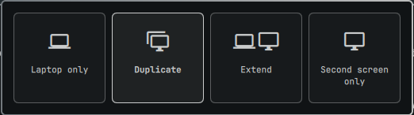

# Display Mode for Omarchy

**English** · [Español](README.es.md)

A Win+P style display switcher for the [Omarchy](https://omarchy.org/) bar. Click the icon, pick one of four cards, and your laptop and second screen rearrange themselves.



| Mode | What it does |
|------|--------------|
| **Laptop only** | Everything lives on the laptop. The second screen stays on and shows the Omarchy screensaver, with no bar, windows, or workspaces. |
| **Duplicate** | Both screens show the same image at the highest resolution they share, copied pixel for pixel with no compositor scaling. |
| **Extend** | The second screen sits to the right of the laptop and always starts on workspace 2. |
| **Second screen only** | The laptop panel turns off and everything moves to the second screen. |

The chosen mode survives reloads and reboots. Unplug the second screen and the laptop comes back on by itself; plug it in again and the last mode is restored.

## Requirements

- Omarchy with third-party shell plugins (Quickshell-based `omarchy-shell`)
- Hyprland with the Lua config Omarchy ships
- A laptop with a built-in panel (`eDP`, `LVDS`, or `DSI`) and one external display
- `jq`, `socat`, `grim`, and `ttfx`, all part of a stock Omarchy install

## Install

```sh
omarchy plugin add https://github.com/AldoHassiel/omarchy-display-mode.git --enable
```

The icon lands just right of the clock. To put it somewhere else:

```sh
omarchy bar move aldo.display-mode --section right
```

Nothing changes on your displays until you pick a mode for the first time. At that point the plugin appends one include to the end of `~/.config/hypr/hyprland.lua`, so its generated rules in `~/.config/hypr/display-mode.lua` load last.

## Use

Click the bar icon to open the four cards.

| Action | Keys |
|--------|------|
| Move between cards | `h` `j` `k` `l`, arrow keys, or the mouse |
| Apply the highlighted card | `Enter`, `Space`, or click |
| Apply a card directly | `1` `2` `3` `4` |
| Close | `Esc` or click outside |

The card for the active mode is highlighted, and the bar icon changes with it. Without a second screen connected, only **Laptop only** is available.

To open the panel from a keybinding, add this to `~/.config/hypr/bindings.lua` with a key of your choice:

```lua
o.bind("SUPER + CTRL + P", "Display mode", "omarchy-shell aldo.display-mode toggle")
```

The same modes are available from a terminal, which also gets you out of a blank screen:

```sh
~/.config/omarchy/plugins/aldo.display-mode/display-mode set internal   # or duplicate, extend, external
~/.config/omarchy/plugins/aldo.display-mode/display-mode status
```

## Duplicate and sharpness

By default, Duplicate does what Windows does: both screens run at the highest resolution they have in common, at scale 1, so nothing is resampled by the compositor. On a 1366×768 laptop with a 1080p monitor, that means both run at 1366×768 and the monitor upscales the signal itself.

If you would rather drive the second screen at its native resolution and let the laptop show a downscaled copy, set the strategy on the widget entry in `~/.config/omarchy/shell.json`:

```json
{ "id": "aldo.display-mode", "duplicate": "external" }
```

Duplicate also switches to a software cursor, which avoids a frozen second pointer on the mirrored screen.

## Laptop only and the screensaver

In this mode the second screen is parked far outside the desktop, so the pointer cannot reach it. It shows its own always-on copy of the Omarchy screensaver (`~/.config/omarchy/branding/screensaver.txt`), which does not close on key presses. Workspaces 1–10 are bound to the laptop, and any window or focus that ends up on the parked screen is sent straight back.

## Working alongside hyprmoncfg

[hyprmoncfg](https://hyprmoncfg.dev/) insists on loading its monitor rules last and only yields to Omarchy's mirror toggle. While a mode is active, this plugin uses that toggle file (`~/.local/state/omarchy/toggles/hypr/internal-monitor-mirror.lua`) as a bridge to its own rules, so the two can coexist. As a side effect, Omarchy's own "mirror laptop display" shortcut clears the chosen mode until you pick one again.

## Limitations

- One built-in panel and one external display. With several external displays, only the first is managed.
- All modes use scale 1.
- Switching modes takes a few seconds while the screens settle.
- Editing the plugin's files needs `omarchy restart shell` to take effect, because the plugin is kept loaded.

## Remove

```sh
~/.config/omarchy/plugins/aldo.display-mode/display-mode set extend
omarchy plugin remove aldo.display-mode
```

Then delete what the plugin left behind:

- the `BEGIN aldo.display-mode` … `END aldo.display-mode` block at the end of `~/.config/hypr/hyprland.lua`
- `~/.config/hypr/display-mode.lua`
- `~/.local/state/aldo-display-mode/`
- `~/.local/state/omarchy/toggles/hypr/internal-monitor-mirror.lua`, if its first line mentions `aldo.display-mode`

Run `hyprctl reload` afterwards.

## Development

```sh
git clone https://github.com/AldoHassiel/omarchy-display-mode.git ~/Projects/display-mode
ln -s ~/Projects/display-mode ~/.config/omarchy/plugins/aldo.display-mode
omarchy plugin validate ~/Projects/display-mode
```

| File | Role |
|------|------|
| `manifest.json` | Plugin metadata: a bar widget plus a background service |
| `Panel.qml` | Bar icon and the four-card panel |
| `Service.qml` | Keeps the hotplug watcher running |
| `display-mode` | Bash script that generates the Hyprland rules and manages the screensaver |
| `i18n/` | Card labels (`en`, `es`); the panel follows the language set in Omarchy |

## License

MIT
